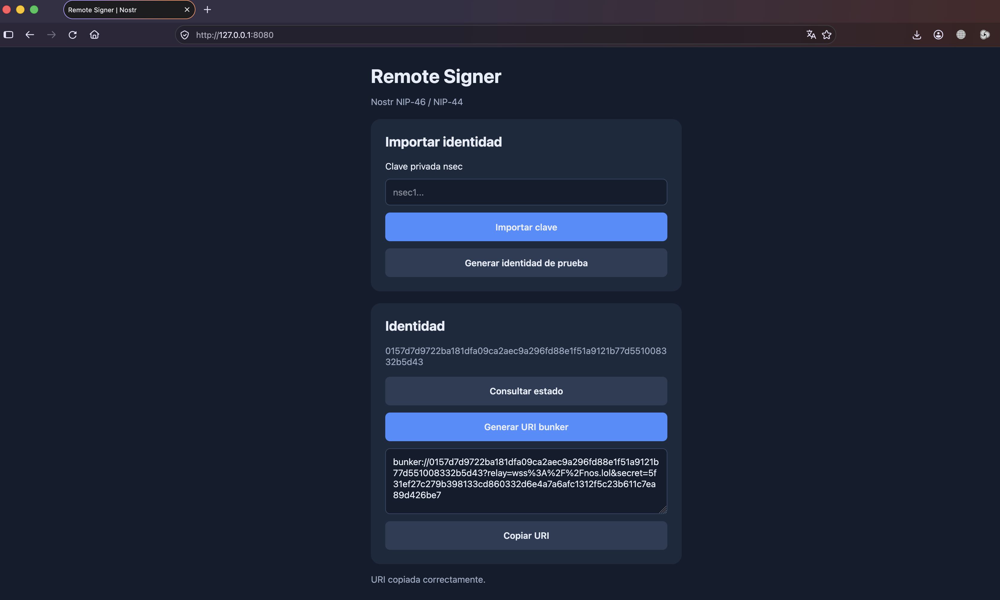
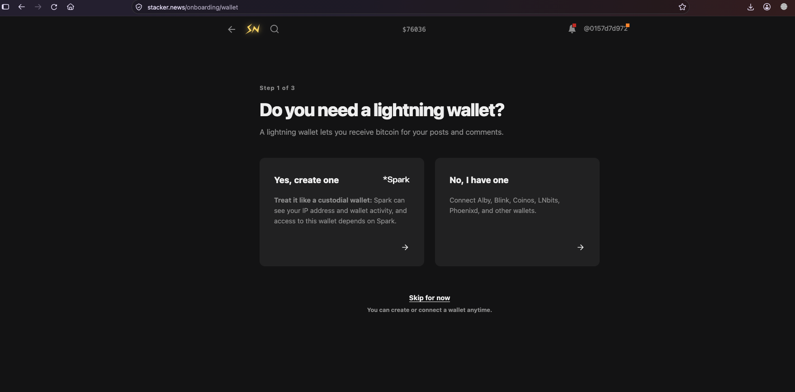

# Nostr Remote Signer --- MVP

**Proyecto:** Remote Signer basado en Nostr NIP-46 / NIP-44\
**Módulo Go:** `github.com/pablogandolfo/nostr-nip46-signer`\
**Propósito:** prueba técnica y demostrador funcional\
**Estado:** MVP sujeto a validación de interoperabilidad y revisión de
seguridad

## 1. Descripción

Este proyecto implementa un servicio de firma remota para el ecosistema
Nostr. Su objetivo es mantener la clave privada del usuario bajo control
del servicio signer y permitir que clientes compatibles soliciten
operaciones criptográficas mediante el protocolo NIP-46.

El MVP contempla:

-   Gestión de una identidad Nostr mediante importación de `nsec` o
    generación de una identidad de prueba.
-   Custodia de la clave privada en memoria del proceso, sin
    persistencia intencional en archivos ni bases de datos.
-   Transporte de solicitudes y respuestas mediante relays Nostr
    WebSocket.
-   Cifrado de mensajes de comunicación mediante NIP-44.
-   Procesamiento acotado de comandos NIP-46.
-   Interfaz web mínima en HTML, CSS y JavaScript nativo.
-   Endpoints HTTP para administración y consulta del estado.
-   Cabeceras HTTP de seguridad y limitación de solicitudes en memoria.

> **Advertencia de alcance:** la ausencia de persistencia en disco no
> equivale a una garantía absoluta de eliminación forense. El sistema
> operativo, el runtime, volcados de memoria, swap, mecanismos de
> depuración o copias temporales pueden conservar datos. La seguridad
> debe evaluarse considerando el host completo.

## 2. Arquitectura

La solución sigue una organización modular:

``` text
.
├── cmd/
│   └── main.go
├── internal/
│   ├── config/
│   ├── keyvault/
│   │   └── vault.go
│   ├── nip46/
│   │   └── signer.go
│   └── web/
│       └── server.go
├── static/
│   └── index.html
├── docs/
│   ├── threat_model.md
│   └── ai_chat_logs.md
├── go.mod
├── go.sum
└── README.md
```

### 2.1 Componentes

  -----------------------------------------------------------------------
  Componente                          Responsabilidad
  ----------------------------------- -----------------------------------
  `cmd/main.go`                       Inicialización, configuración del
                                      servidor HTTP y apagado controlado.

  `internal/config/`                  Carga y validación de
                                      configuración.

  `internal/keyvault/`                Custodia en memoria, validación y
                                      operaciones controladas sobre
                                      claves.

  `internal/nip46/`                   Sesiones, comunicación con relays,
                                      cifrado NIP-44 y comandos NIP-46.

  `internal/web/`                     API HTTP, middleware, cabeceras y
                                      rate limiting.

  `static/`                           Interfaz de administración sin
                                      frameworks externos.

  `docs/`                             Documentación técnica y registro
                                      del proceso de desarrollo.
  -----------------------------------------------------------------------

### 2.2 Flujo lógico

1.  El operador inicia el servicio en un entorno controlado.
2.  Se importa una clave Nostr o se genera una identidad de prueba.
3.  El vault mantiene el material secreto en memoria durante la vida del
    proceso.
4.  El signer establece comunicación con los relays configurados.
5.  Un cliente NIP-46 solicita una operación mediante el canal cifrado.
6.  El signer valida el origen, la sesión, el comando y sus parámetros.
7.  Si la solicitud está autorizada, ejecuta la operación permitida y
    devuelve una respuesta cifrada.

La implementación debe validar de forma estricta la identidad del
cliente, el secreto de emparejamiento, los permisos concedidos y el
contenido de cada evento. No debe asumirse que el cifrado del transporte
autoriza por sí solo una operación.

## 3. Requisitos previos

-   Go **1.27 o superior**, de acuerdo con el requisito de la prueba
    técnica.
-   Git.
-   Docker Engine y Docker CLI para ejecución contenerizada.
-   Acceso de red saliente a los relays Nostr configurados mediante
    WebSocket seguro (`wss://`).
-   Un sistema operativo soportado por Go.
-   Dependencia criptográfica y de protocolo:
    `github.com/nbd-wtf/go-nostr`.

Verificar herramientas:

``` bash
go version
git --version
docker --version
```

Verificar el módulo:

``` bash
go list -m
go list -m github.com/nbd-wtf/go-nostr
```

## 4. Configuración

Los valores operativos ---dirección HTTP, relays, límites, timeouts y
nivel de logging--- deben centralizarse en `internal/config/` o
variables de entorno. No deben almacenarse claves privadas, secretos de
emparejamiento ni credenciales en el repositorio.

Ejemplo de relays de desarrollo:

``` text
wss://relay.damus.io
wss://nos.lol
```

Los relays son servicios externos y no deben considerarse confiables. El
signer debe validar criptográficamente los mensajes recibidos y manejar
desconexiones, duplicados, eventos fuera de orden y respuestas
malformadas.

## 5. Ejecución local

Desde la raíz del repositorio:

``` bash
go mod download
go mod tidy
gofmt -w ./cmd ./internal
go test ./...
go run ./cmd/main.go
```

Si el servidor utiliza el puerto local `8080`, abrir:

``` text
http://127.0.0.1:8080/
```

Comprobar el estado:

``` bash
curl -i http://127.0.0.1:8080/api/status
```

La respuesta esperada cuando no existe una identidad cargada es HTTP
`200` con `initialized: false`. Una vez inicializado el vault, la
respuesta debe indicar `initialized: true` y exponer únicamente la clave
pública (`npub` o su representación definida por la API).

Generar una identidad de prueba:

``` bash
curl -i -X POST \
  http://127.0.0.1:8080/api/key/generate
```

Consultar la URI bunker:

``` bash
curl -i http://127.0.0.1:8080/api/bunker
```

**No utilizar claves privadas reales en pruebas automatizadas, capturas
de pantalla, logs, terminales compartidos ni entornos de demostración.**

## 6. Ejecución con Docker

### 6.1 Consideración obligatoria sobre la dirección de escucha

El servidor debe escuchar en `0.0.0.0:8080` **dentro del contenedor**
para que Docker pueda publicar el puerto. Una aplicación que escucha
exclusivamente en `127.0.0.1:8080` dentro del contenedor no será
accesible mediante el mapeo de puertos del host.

Por tanto, antes de construir la imagen, configurar la dirección de
escucha mediante una variable de entorno, por ejemplo `HTTP_ADDR=:8080`,
y hacer que `cmd/main.go` la consuma. No se debe cambiar la dirección de
escucha del modo local si se desea mantener el acceso exclusivamente
local fuera de Docker.

### 6.2 Dockerfile de referencia

Crear un archivo `Dockerfile` en la raíz:

``` dockerfile
# Etapa de compilación
FROM golang:1.27-alpine AS builder

WORKDIR /src

RUN apk add --no-cache ca-certificates

COPY go.mod go.sum ./
RUN go mod download

COPY . .
RUN CGO_ENABLED=0 GOOS=linux go build \
    -trimpath \
    -ldflags="-s -w" \
    -o /out/remote-signer ./cmd/main.go

# Imagen de ejecución
FROM alpine:3

RUN apk add --no-cache ca-certificates wget \
    && addgroup -S signer \
    && adduser -S -G signer signer

WORKDIR /app

COPY --from=builder /out/remote-signer /app/remote-signer
COPY --chown=signer:signer static/ /app/static/

USER signer:signer

ENV HTTP_ADDR=:8080

EXPOSE 8080

HEALTHCHECK --interval=30s --timeout=5s --start-period=10s --retries=3 \
  CMD wget -q -O /dev/null http://127.0.0.1:8080/api/status || exit 1

ENTRYPOINT ["/app/remote-signer"]
```

El ejemplo presupone que `cmd/main.go` lee `HTTP_ADDR` y utiliza
`/app/static` como directorio de recursos estáticos, o que el proceso se
ejecuta con `/app` como directorio de trabajo. Deben verificarse ambos
puntos en la implementación real.

La etiqueta `golang:1.27-alpine` debe estar disponible en el registro
utilizado. Si la versión requerida no estuviera publicada en el entorno
de evaluación, utilizar una versión aprobada por el organismo y
documentar la desviación.

### 6.3 Construcción

``` bash
docker build -t nostr-remote-signer:latest .
```

### 6.4 Ejecución defensiva

``` bash
docker run -d \
  --name nostr-remote-signer \
  --init \
  --read-only \
  --tmpfs /tmp:rw,noexec,nosuid,size=16m \
  --cap-drop ALL \
  --security-opt no-new-privileges:true \
  --pids-limit 100 \
  --memory 256m \
  --cpus 1 \
  -p 127.0.0.1:8080:8080 \
  nostr-remote-signer:latest
```

El mapeo `127.0.0.1:8080:8080` limita el acceso publicado al loopback
del host. No sustituye autenticación ni controles de acceso de la
aplicación.

### 6.5 Healthcheck

Consultar manualmente:

``` bash
docker inspect \
  --format='{{json .State.Health}}' \
  nostr-remote-signer
```

O ejecutar el mismo chequeo utilizado por Docker:

``` bash
docker exec nostr-remote-signer \
  wget -q -O /dev/null \
  http://127.0.0.1:8080/api/status
```

El endpoint `/api/status` funciona aquí como comprobación básica de
disponibilidad HTTP. **No acredita que los relays estén conectados, que
NIP-46 funcione, que el vault esté inicializado ni que el servicio esté
listo para procesar firmas.** Para readiness se recomienda implementar
un endpoint independiente que compruebe las dependencias necesarias sin
revelar secretos.

### 6.6 Operación

``` bash
docker logs nostr-remote-signer
docker stop nostr-remote-signer
docker rm nostr-remote-signer
```

No montar volúmenes para almacenar claves privadas. No habilitar
privilegios elevados ni montar el socket Docker dentro del contenedor.

## 7. API HTTP

  Método   Ruta                  Propósito
  -------- --------------------- -----------------------------------
  `POST`   `/api/key/import`     Importar una clave privada Nostr.
  `POST`   `/api/key/generate`   Generar una identidad de prueba.
  `GET`    `/api/status`         Consultar estado y clave pública.
  `GET`    `/api/bunker`         Obtener URI de conexión bunker.

Los endpoints que modifican el estado del vault deben estar protegidos
por autenticación administrativa y controles CSRF antes de cualquier
despliegue compartido o remoto. El rate limiting no sustituye estos
controles.

## 8. Controles de seguridad previstos

-   Custodia del material secreto en memoria del proceso.
-   No persistencia intencional de claves privadas en archivos o bases
    de datos.
-   Cifrado de mensajes NIP-46 mediante NIP-44.
-   Validación de comandos y parámetros según una lista permitida.
-   Rate limiting por IP y endpoint.
-   Cabeceras HTTP: `X-Frame-Options`, `X-Content-Type-Options`, CSP y
    `Referrer-Policy`.
-   Límites de tamaño del cuerpo HTTP.
-   Ejecución contenerizada con usuario no privilegiado, filesystem de
    solo lectura y capacidades Linux eliminadas.
-   Pruebas de concurrencia y análisis de dependencias antes de la
    entrega.

**Nota de Seguridad sobre la API de Administración (MVP Tradeoff):**

Para mantener la simplicidad del MVP, los endpoints bajo /api/ están diseñados exclusivamente para consumo local (127.0.0.1). En esta versión no se incluye token de sesión administrativo ni validación de Host/Origin para las llamadas HTTP locales. Para un despliegue en producción o entornos compartidos, se requiere incorporar un token de administración (X-Admin-Token) y validación estricta de encabezados anti-CSRF / DNS-Rebinding.

## 9. Validación previa a la entrega

``` bash
gofmt -w ./cmd ./internal
go vet ./...
go test ./...
go test -race ./...
govulncheck ./...
```

Las pruebas deben cubrir, como mínimo:

-   Importación y generación de claves.
-   Cierre del vault y rechazo de operaciones posteriores.
-   Acceso concurrente al vault y sustitución de identidades.
-   Validación de emparejamiento y autorización de sesiones NIP-46.
-   Cifrado y descifrado NIP-44 con vectores de prueba.
-   Rechazo de comandos no permitidos y eventos fuera del alcance
    definido.
-   Límites de solicitudes y respuestas HTTP `429`.
-   Cabeceras de seguridad en respuestas exitosas y de error.
-   Comportamiento ante desconexión y reconexión de relays.

No declarar estas pruebas como aprobadas hasta contar con resultados
reproducibles y evidencia de ejecución.

## 10. Limitaciones conocidas y trabajo pendiente

Este repositorio corresponde a un MVP. Antes de producción deben
verificarse, entre otros aspectos:

1.  Interoperabilidad real con clientes NIP-46, incluyendo el flujo de
    autenticación objetivo.
2.  Separación entre la identidad del usuario y la identidad/clave de
    transporte del bunker, según el perfil NIP-46 implementado.
3.  Aprobación explícita y granular de operaciones de firma.
4.  Autenticación administrativa, protección CSRF y política de
    orígenes.
5.  Reconexión de relays, gestión de duplicados y límites de mensajes.
6.  Protección del host frente a swap, core dumps, depuración y acceso
    privilegiado.
7.  Política de logging que excluya claves, secretos, URI bunker y
    payloads sensibles.
8.  Revisión criptográfica y pruebas de penetración independientes.

## 11. Interoperabilidad y Soporte Extendido (Stacker News)

El remote signer incluye extensiones robustas validadas en entornos de producción:
- **Cifrado Dual (NIP-04 y NIP-44):** Detección automática del esquema de cifrado del cliente. Permite interactuar tanto con clientes modernos (NIP-44) como con plataformas legadas o específicas como Stacker News (NIP-04).
- **Autenticación HTTP (NIP-98 / Kind 27235):** Soporte de firma acotado estrictamente para peticiones autenticadas HTTP con validación de dominios permitidos (`stacker.news`) y control de frescura de eventos.

## 12. Referencias

-   Nostr NIP-46: Remote Signing.
-   Nostr NIP-44: Encrypted Payloads.
-   Documentación oficial de Go: https://go.dev/doc/
-   Repositorio de `go-nostr`: https://github.com/nbd-wtf/go-nostr
-   Documentación de Docker: https://docs.docker.com/
-   OWASP Secure Headers Project:
    https://owasp.org/www-project-secure-headers/

------------------------------------------------------------------------

**Nota de entrega:** registrar en el expediente de la prueba la versión
del código, el commit, la versión de Go, la imagen base utilizada, los
resultados de pruebas y las desviaciones respecto de este documento.

## Demostración de Interoperabilidad

1. **Panel de Administración Web:** Generación de identidad y URI `bunker://` con relay y secreto de emparejamiento.


2. **Inicio de Sesión Exitoso:** Autenticación HTTP (NIP-98 / Kind 27235) validada en Stacker News mediante el Remote Signer en Go.


3. **Video del Flujo Completo:** Puedes ver el video de demostración que muestra el funcionamiento de principio a fin (generación de identidad en el Remote Signer y autenticación exitosa en Stacker News):
👉 **[Ver Video de Demostración (MP4)](docs/assets/demo-flow.mp4)**

4. **Verificación de Seguridad y API Guard:** Salidas detalladas de las pruebas `curl`, validación del token de administración en consola y cabeceras de seguridad HTTP:
👉 **[Ver Documento de Evidencias de Seguridad (MD)](docs/verification.md)**
------------------------------------------------------------------------